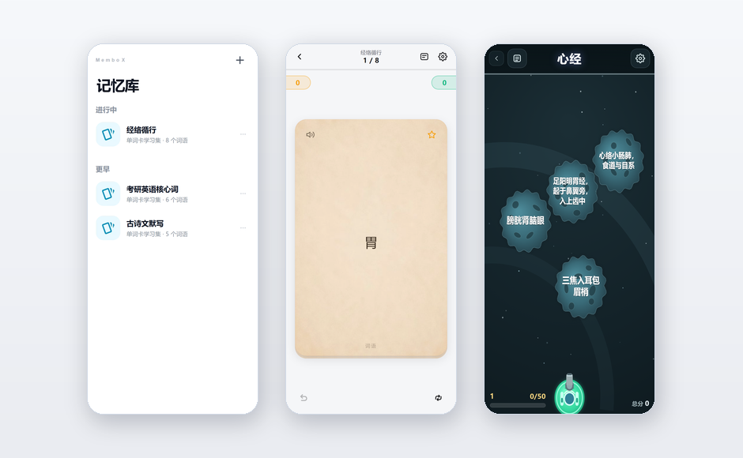
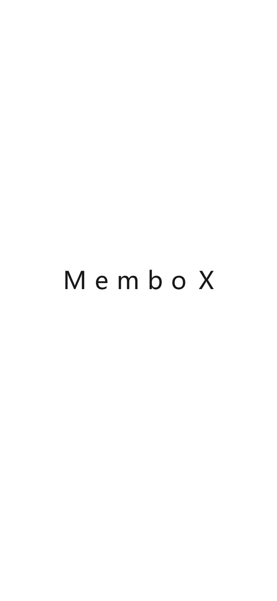
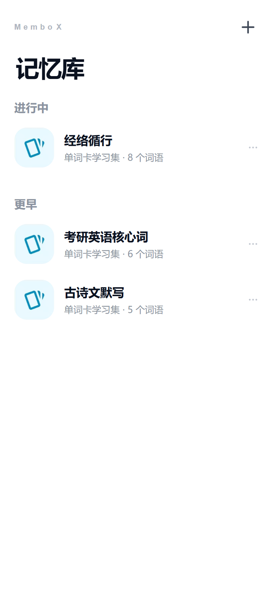
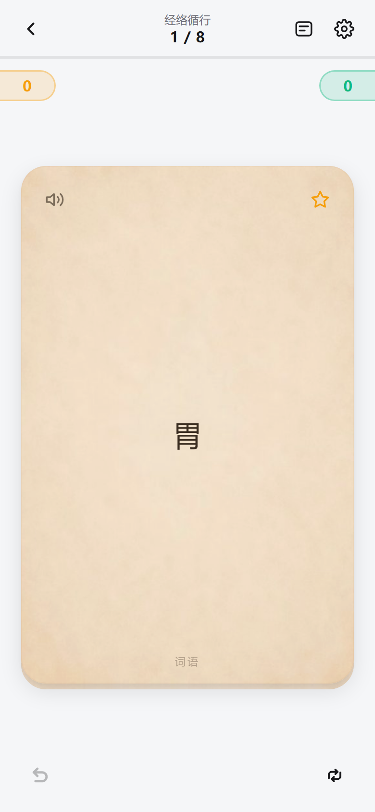
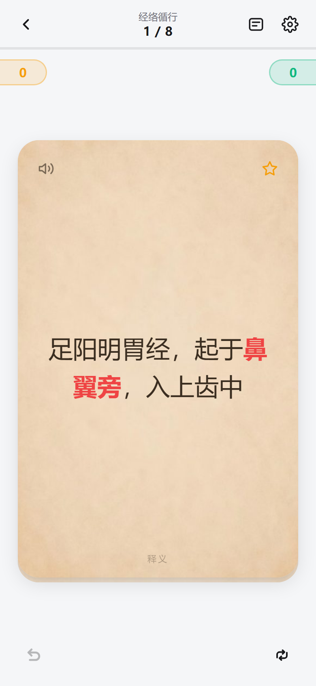
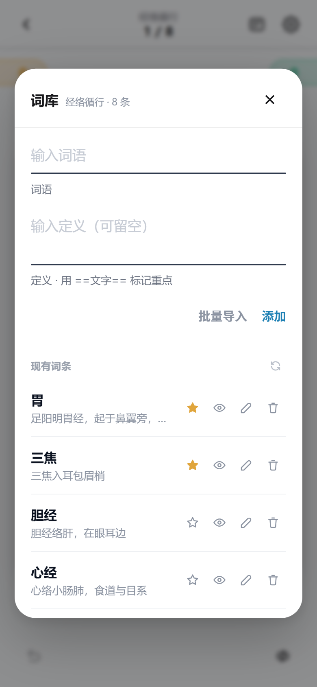
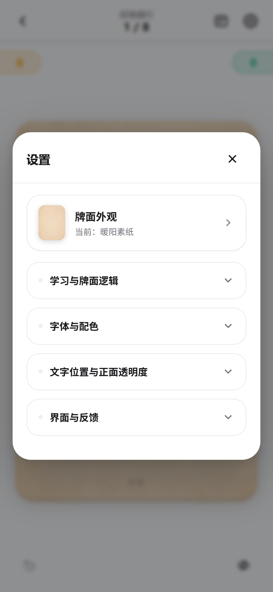
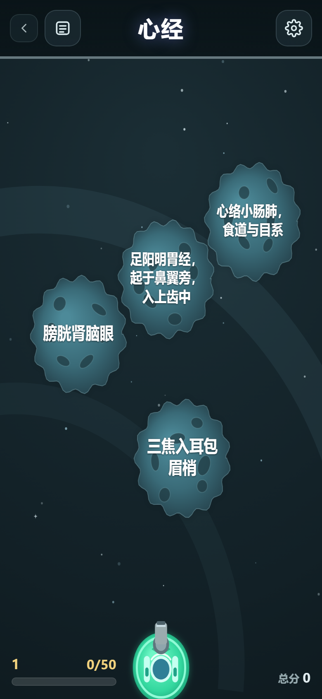

# Membo X

> One HTML file, and also an Android app. A local-first, fully offline flashcard tool.

[中文说明 →](./README.md) · [Try it in your browser](https://qhdn876.github.io/membo-x/app/) · [Downloads & Releases](https://github.com/qhdn876/membo-x/releases) · [Privacy Policy](https://qhdn876.github.io/membo-x/privacy-en.html)



---

## What it is

Membo X is a local-first flashcard tool. Build study sets, flip cards to test yourself, swipe left/right to sort them into "unfamiliar / familiar", favorite and shuffle entries, and train with **Blast** — a mode that turns your terms into targets to shoot down. No sign-up, no network permission, all data stays on the device, and uninstalling removes it.

The Android package declares **zero permissions** — the system shows no permission prompt at install time.

Core features:

| Feature | Description |
|---|---|
| Study sets | Create, rename, pin, and delete sets; edit single entries or bulk-import them |
| Card flipping | Tap to reveal the definition; wrap text in `==...==` to highlight key parts; optional read-aloud |
| Swipe to sort | Left = unfamiliar, right = familiar, with live counters; undo, shuffle, and review-only-unfamiliar |
| Favorites & hide | Star entries, temporarily hide them, or switch to "favorites only" |
| Blast training | Shoot asteroids labelled with your entries; multi-segment health and paced firing for a different kind of repetition |
| Appearance | Three built-in card themes, custom colors, font size, text position, front/back background opacity |
| Offline by design | The web build is a PWA (add to home screen, cached offline); the APK is simply a bundled local HTML file |

---

## Get it

The same page ships in four forms, all on [GitHub Releases](https://github.com/qhdn876/membo-x/releases):

| Form | Download | Best for |
|---|---|---|
| **Web version online** | [Open directly](https://qhdn876.github.io/membo-x/app/) | Any phone or desktop browser; "Add to Home Screen" works, offline-capable |
| **Single-file HTML** | [MemboX-HTML-v1.0.11.html](https://github.com/qhdn876/membo-x/releases/download/v1.0.11/MemboX-HTML-v1.0.11.html) | Double-click to open in a browser; no dependencies, no server, easy to share as one file |
| **Web / PWA bundle** | [MemboX-Web-PWA-v1.0.11.zip](https://github.com/qhdn876/membo-x/releases/download/v1.0.11/MemboX-Web-PWA-v1.0.11.zip) | Self-hosting on any static server; includes `manifest`, `sw.js`, icons, and `locales/` SEO metadata |
| **Android APK** | [MemboX-v1.0.11.apk](https://github.com/qhdn876/membo-x/releases/download/v1.0.11/MemboX-v1.0.11.apk) | Android 7.0+, ~328 KB, release-signed |

---

## Screenshots

Every screenshot is rendered from the actual page in a headless browser. Originals live in [`docs/screenshots/`](docs/screenshots/) (780 × 1688).

<table>
  <tr>
    <td align="center"><br>Launch screen</td>
    <td align="center"><br>Study sets</td>
    <td align="center"><br>Card front</td>
  </tr>
  <tr>
    <td align="center"><br>Card back · highlights</td>
    <td align="center"><br>Deck manager / bulk import</td>
    <td align="center"><br>Settings / card themes</td>
  </tr>
  <tr>
    <td align="center"><br>Blast training mode</td>
    <td colspan="2" align="left">All seven screenshots plus the <code>overview.png</code> triptych are in <a href="docs/screenshots/">docs/screenshots/</a>.</td>
  </tr>
</table>

---

## Privacy & permissions

- **Zero permissions**: `AndroidManifest.xml` declares no `uses-permission` at all — not even `INTERNET`. The app physically cannot reach the network.
- **Zero collection**: no personal data is collected or uploaded; no accounts, no cloud copy.
- **Zero third parties**: no analytics, crash reporting, ads, push, or social login SDKs. No ads, no in-app purchases, no outbound links.
- **Local storage only**: sets, progress, and settings stay in device-local storage, unreadable by other apps; uninstalling removes them permanently.

**Privacy policy**: <https://qhdn876.github.io/membo-x/privacy-en.html>

## Project layout

```
.
├── app/src/main/
│   ├── assets/index.html        ← app page, all CSS / JS inlined
│   ├── java/com/membo/app/      ← WebView host, launch animation, JS bridge
│   ├── res/                     ← adaptive icons, themes, splash image
│   └── AndroidManifest.xml      ← zero permissions
├── docs/
│   ├── index.html               ← project home page
│   ├── privacy.html             ← privacy policy
│   ├── app/                     ← playable web / PWA build
│   └── screenshots/             ← app screenshots
├── tools/                       ← page sync, web/PWA, and asset build scripts
└── icon_final.png               ← icon source
```

The whole app is a single HTML file with all CSS and JavaScript inlined. Its Android form is served through `WebViewAssetLoader` on a virtual https origin (`appassets.androidplatform.net`), which avoids the storage restrictions of `file://`. The native side is plain Java with no UI framework — it only handles the launch animation, system bars, and a JS bridge. The web build uses the same HTML plus a `manifest` and Service Worker, making it an installable offline PWA.

---

## Links

- Try it online (Web / PWA): <https://qhdn876.github.io/membo-x/app/>
- Privacy policy: <https://qhdn876.github.io/membo-x/privacy-en.html>
- Chinese README: [README.md](./README.md)
- Downloads (HTML, web bundle, APK): <https://github.com/qhdn876/membo-x/releases>
