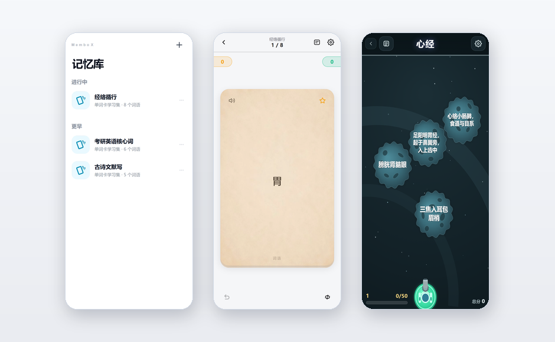
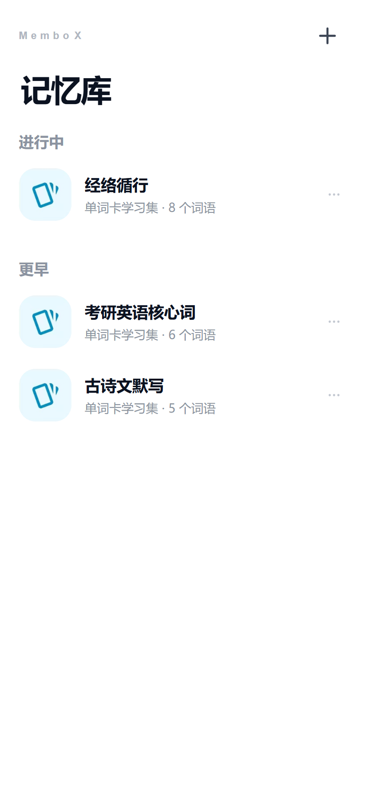
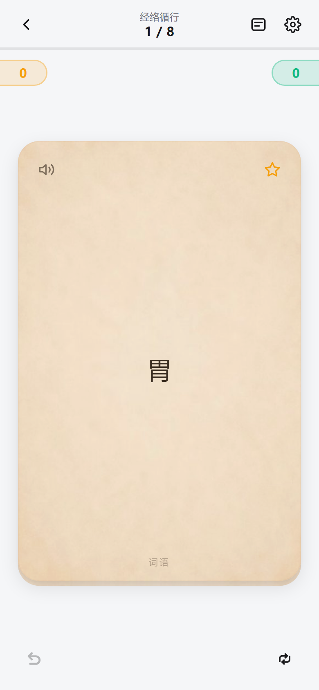
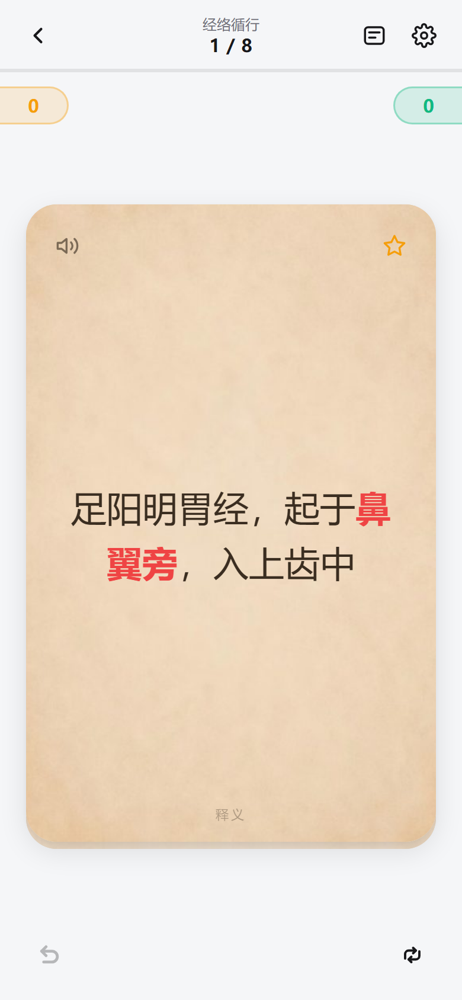
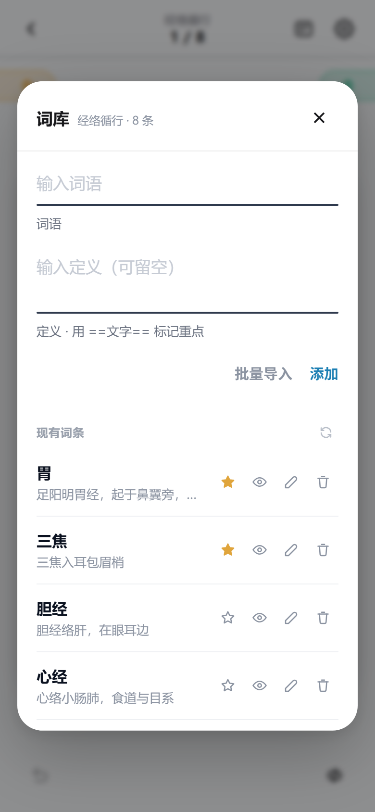
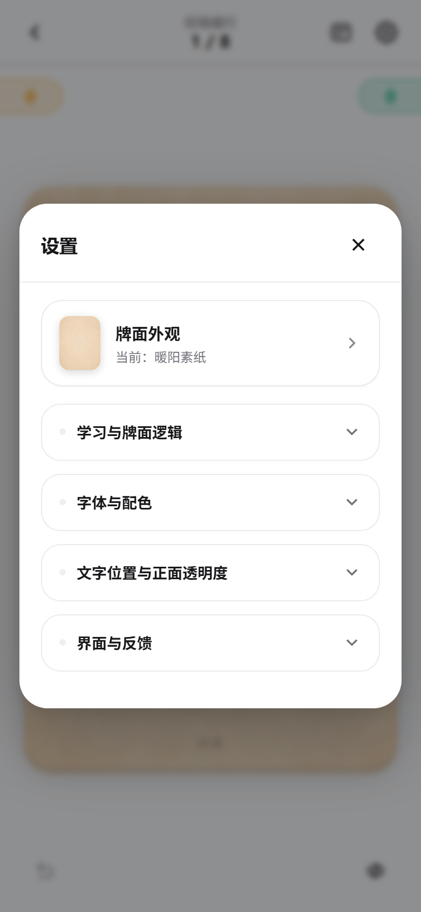
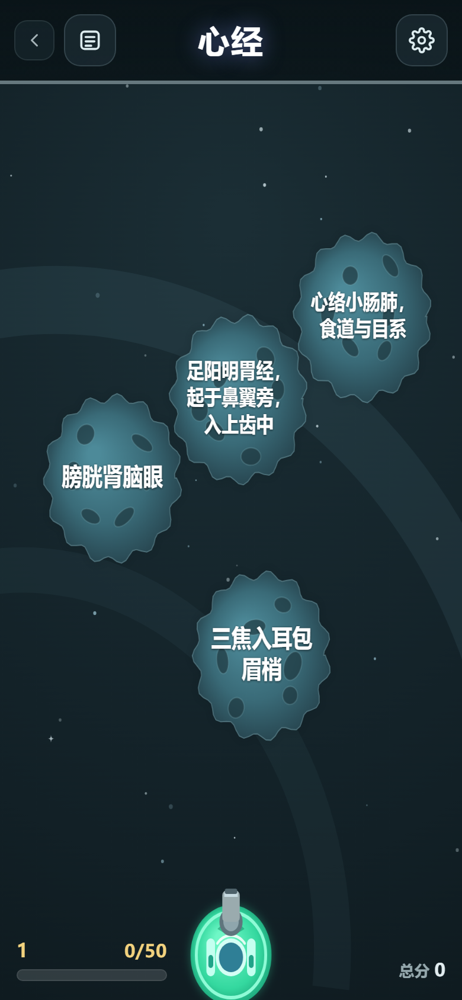

# Membo X

> 一款本地优先的记忆卡片工具，含在线版 / HTML / APK 版。

[English version →](./README.en.md) · [在线体验 Web 版](https://qhdn876.github.io/membo-x/app/) · [下载与 Releases](https://github.com/qhdn876/membo-x/releases) · [隐私政策](https://qhdn876.github.io/membo-x/privacy.html)



---

## 这是什么
Membo X 是一款本地优先的记忆卡片工具。支持卡片翻转、左右滑动分类、收藏与打乱，内置 Blast 记忆训练模式，数据只存本机，卸载即删。

整个 Android 包**没有声明任何权限**，安装时系统不会弹出一个权限请求。

核心功能：

| 功能 | 说明 |
|---|---|
| 学习集管理 | 新建 / 重命名 / 置顶 / 删除学习集，支持单条编辑与批量导入词条 |
| 卡片翻转 | 点击翻面查看释义，`==文字==` 可标记重点并高亮；支持朗读 |
| 滑动分类 | 左滑「不熟悉」、右滑「熟悉」，实时计数，可撤回、洗牌、只练不熟悉的卡片 |
| 收藏与屏蔽 | 星标收藏、临时屏蔽词条，可切换「仅收藏」 |
| Blast 训练 | 看题射击击碎岩体，多段血量、分段节奏，用另一种方式反复过词 |
| 外观自定义 | 三套内置牌面、自定义配色、字号、文字位置、正背面背景透明度 |

---

## 下载与使用

四种分发形态，都在 [GitHub Releases](https://github.com/qhdn876/membo-x/releases) 上：

| 形态 | 下载 | 适用 |
|---|---|---|
| **在线 Web 版** | [直接打开](https://qhdn876.github.io/membo-x/app/) | 手机 / 电脑浏览器，可「添加到主屏幕」当 App 用，支持离线 |
| **单文件 HTML** | [MemboX-HTML-v1.0.11.html](https://github.com/qhdn876/membo-x/releases/download/v1.0.11/MemboX-HTML-v1.0.11.html) | 下载后双击用浏览器打开，零依赖、无需服务器、可直接分享文件 |
| **Web / PWA 包** | [MemboX-Web-PWA-v1.0.11.zip](https://github.com/qhdn876/membo-x/releases/download/v1.0.11/MemboX-Web-PWA-v1.0.11.zip) | 想自己部署到静态托管；含 `manifest`、`sw.js`、图标与 `locales/` 多语言 SEO 配置 |
| **Android APK** | [MemboX-v1.0.11.apk](https://github.com/qhdn876/membo-x/releases/download/v1.0.11/MemboX-v1.0.11.apk) | Android 7.0 及以上，约 328 KB，正式签名包 |


---

## 界面一览

截图均由本项目页面在无头浏览器中真实渲染生成，原始文件在 [`docs/screenshots/`](docs/screenshots/)（780 × 1688）。

<table>
  <tr>
    <td align="center"><br>启动页</td>
    <td align="center"><br>记忆库 / 学习集</td>
    <td align="center"><br>卡片正面</td>
  </tr>
  <tr>
    <td align="center"><br>卡片背面 · 重点高亮</td>
    <td align="center"><br>词库管理 / 批量导入</td>
    <td align="center"><br>设置 / 牌面外观</td>
  </tr>
  <tr>
    <td align="center"><br>Blast 记忆训练</td>
    <td colspan="2" align="left">全部 7 张截图 + 三联展示图 <code>overview.png</code> 都在 <a href="docs/screenshots/">docs/screenshots/</a>。</td>
  </tr>
</table>

---

## 隐私与权限

- **零权限**：`AndroidManifest.xml` 未声明任何 `uses-permission`，连 `INTERNET` 都没有，不联网。
- **零收集**：不收集、不上传任何个人信息；无账号体系，无云端副本。
- **零第三方**：不集成统计、崩溃上报、广告、推送、社交登录等任何 SDK；无广告、无内购、无跳转外链。
- **本地存储**：学习集、进度与设置只存设备本地，其他应用无法读取；卸载即彻底删除。

**隐私政策**：<https://qhdn876.github.io/membo-x/privacy.html>

## 工程结构

```
.
├── app/src/main/
│   ├── assets/index.html        ← 应用页面，内联全部 CSS / JS
│   ├── java/com/membo/app/      ← WebView 宿主、启动动画、JS 桥
│   ├── res/                     ← 自适应图标、主题、启动图
│   └── AndroidManifest.xml      ← 零权限
├── docs/
│   ├── index.html               ← 项目主页
│   ├── privacy.html             ← 隐私政策
│   ├── app/                     ← 在线 Web / PWA 版
│   └── screenshots/             ← 应用截图
├── tools/                       ← 页面同步、Web/PWA 与素材构建脚本
└── icon_final.png               ← 图标源文件
```

## 相关链接

- 官网：<https://1234.ccccocccc.cc/?>
- 在线体验（Web / PWA）：<https://qhdn876.github.io/membo-x/app/>
- 隐私政策：<https://qhdn876.github.io/membo-x/privacy.html>
- 下载：<https://github.com/qhdn876/membo-x/releases>
